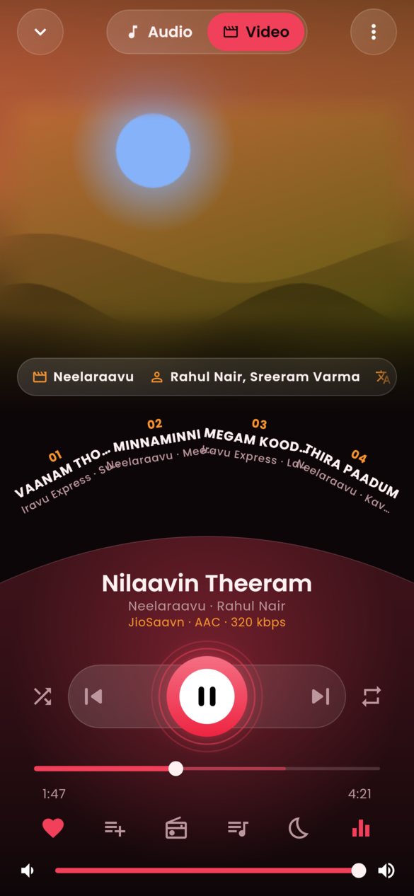
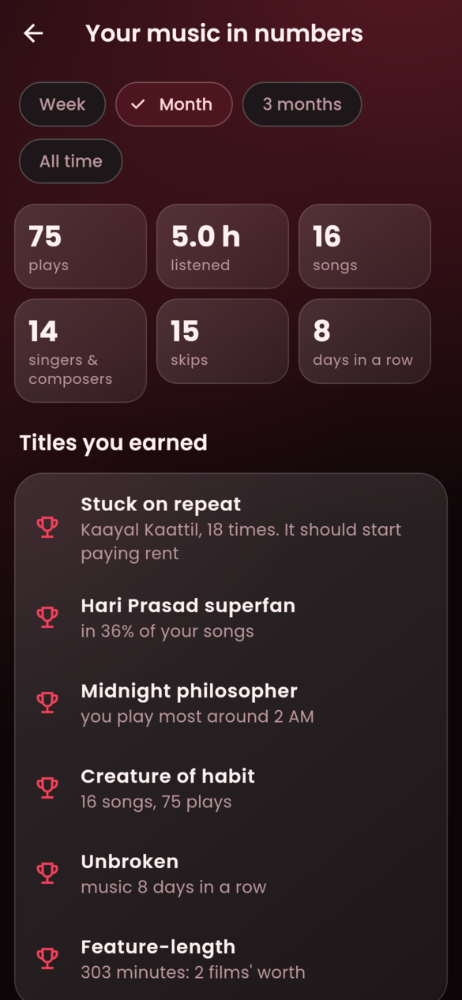
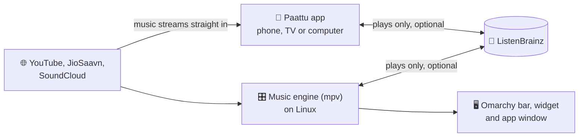

<h1 align="center">
  <br>
  <a href="https://github.com/sudharamachandranrajeev/paattu"></a>
  <br>
  Paattu — പാട്ട് · பாட்டு
  <br>
</h1>

<h4 align="center">Malayalam and Tamil music, free and ad-free, on your phone, TV and computer, and built into Omarchy.</h4>

<p align="center">
  <a href="https://github.com/sudharamachandranrajeev/paattu/releases"></a>
  
  <a href="LICENSE"></a>
</p>

<p align="center">
  <a href="#-what-it-does">What it does</a> •
  <a href="#-get-started">Get started</a> •
  <a href="#-how-it-works">How it works</a> •
  <a href="#-faq-and-troubleshooting">FAQ</a> •
  <a href="#%EF%B8%8F-for-developers">For developers</a>
</p>

<p align="center">
  
</p>

*Paattu* means "song" in both Malayalam and Tamil. It is for people who want film songs and
South Indian music without ads or a paid plan. Follow the YouTube profiles you like, search
JioSaavn, YouTube and SoundCloud, and Paattu plays it all in one place. Status: **stable** (1.0).
It streams from public sites, so a site change can break a source until the next update.

## ✨ What it does

- 🎶 **Follow the music you like** – paste a YouTube profile (a label, a composer, a friend) and
  every public playlist on it becomes a Paattu playlist.
- 🔎 **Search everywhere** – songs, films, albums and singers from JioSaavn (up to 320 kbps),
  YouTube and SoundCloud, or paste a link from almost any music site.
- ❤️ **Your own collection** – Favourites, Saved songs, your own playlists and shuffle buttons
  (mixes) that grow as you listen.
- 📻 **Radio and playlists made for you** – endless radio from any song, a Daily mix, a Weekly
  discovery and the week's charts, shaped by what you play and skip.
- 🎤 **Lyrics and the song's video** – the line being sung over the cover, with English letters
  under it, and the song's video playing softly behind.
- 🎚️ **Sound your way** – a fifteen-band equaliser with presets, bass, treble, surround,
  crossfades and a sleep timer.
- 📥 **Plays without internet** – songs you play to the end are kept on the device (2 GB by
  default), and take over when the connection drops.
- 🔁 **Follows you between devices** – your plays sync through ListenBrainz (a free, open
  listening log), so suggestions match everywhere.
- 🖥️ **At home on Omarchy** – a bar control, a desktop widget, an app window, media keys and a
  `paattu` command. The full list is in the [feature guide](docs/guide.md).

## 📸 Screenshots

<table>
  <tr>
    <td align="center"><br><sub>Home</sub></td>
    <td align="center"><br><sub>Now Playing, Up next on the arc</sub></td>
    <td align="center"><br><sub>Video mode</sub></td>
  </tr>
  <tr>
    <td align="center"><br><sub>Library</sub></td>
    <td align="center"><br><sub>Sound</sub></td>
    <td align="center"><br><sub>Your music in numbers</sub></td>
  </tr>
  <tr>
    <td align="center"><br><sub>Omarchy: Home</sub></td>
    <td align="center"><br><sub>Omarchy: Now playing</sub></td>
    <td align="center"><br><sub>Omarchy: desktop widget</sub></td>
  </tr>
</table>

<p align="center">
  <br>
  <sub>Now Playing on a desktop window</sub>
</p>

<sub>All screenshots show a made-up library (songs, films and singers that don't exist) with drawn
covers, rendered from the current code. More are in the [feature guide](docs/guide.md#more-screenshots).</sub>

## 🚀 Get started

### Step 1 – Download

Open the [releases page](https://github.com/sudharamachandranrajeev/paattu/releases) and, under
the newest release, pick the file for your device:

| Your device | File to download | Works on |
| --- | --- | --- |
| 🤖 Android phone or tablet | `Paattu-<version>-android.apk` | Android 7 and newer |
| 📺 Android TV | `Paattu-<version>-android-tv.apk` | Android TV 7 and newer |
| 🪟 Windows computer | `Paattu-<version>-windows-x64-setup.exe` | Windows 10 (version 1809) and 11 |
| 🐧 Linux computer | `Paattu-<version>-linux-x86_64.AppImage` | Any 64-bit Linux with GTK 3 |
| 🟢 Omarchy, or Linux from the terminal | no download: see the Omarchy steps below | Arch, Debian, Ubuntu, Fedora, openSUSE, Void, Alpine |

Each release also has `SHA256SUMS.txt`, a list of fingerprints to check the files are genuine.

### Step 2 – Install

<details>
<summary><b>🤖 Android and 📺 Android TV</b></summary>

1. Open the downloaded `.apk` (on a TV, copy it over with a USB stick and open it in a file manager).
2. If Android asks, allow your browser or file manager to install unknown apps. This is normal for
   apps from outside the Play Store.
3. Tap **Install**, then **Open**.

</details>

<details>
<summary><b>🪟 Windows</b></summary>

1. Double-click `Paattu-<version>-windows-x64-setup.exe`. No admin rights are needed.
2. Windows may say *"Windows protected your PC"*. The app is not paid-signed yet; that is the only
   reason. Click **More info → Run anyway**.
3. Follow the installer, then open **Paattu** from the Start menu.

Prefer no installer? Download `…-windows-x64-portable.zip`, unzip it anywhere and run `paattu.exe`.

</details>

<details>
<summary><b>🐧 Linux app</b></summary>

1. Open a terminal where the AppImage landed and run `chmod +x Paattu-*.AppImage`.
2. Double-click it, or run `./Paattu-*.AppImage`. It brings its own player and uses your desktop's
   GTK 3.

The `…-linux-x64.tar.gz` also works, but needs mpv's library (libmpv.so.2) installed. The
[Linux and Omarchy guide](docs/omarchy.md#download-notes-for-the-linux-app) lists the package names.

</details>

<details>
<summary><b>🟢 Omarchy, and the <code>paattu</code> command on any Linux</b></summary>

1. Open a terminal and run:
   ```sh
   git clone https://github.com/sudharamachandranrajeev/paattu.git
   cd paattu && ./install.sh
   ```
2. It asks once for your password, to install mpv and Python with your package manager. Nothing
   else runs as root.
3. On Omarchy, open Paattu with **Super+Shift+M**, the music icon in the bar, or
   **Super+Space → Paattu**. Elsewhere, try `paattu --help`.

The Paattu window offers updates when it opens. Remove it with `./install.sh --uninstall`. Details,
the firewall rule and the plugin's parts: [Linux and Omarchy guide](docs/omarchy.md).

</details>

### Step 3 – First launch

The library starts empty. There is no sign-up.

1. **Search for a song**: tap **+ → Search songs**, type a song, film or singer, and tap a result to
   play it.
2. **Follow a YouTube profile**: tap **+ → Add from YouTube** and paste a profile (`@handle`) or a
   playlist link. Its playlists appear under **Library**.
3. **Make a shuffle button**: tap **+ → New mix** and pick languages, profiles or playlists.
4. **Keep what you love**: tap the heart on Now Playing to add the song to Favourites.

Paattu checks for updates by itself and asks before installing one. **Settings → About → Go back to
an earlier version** undoes an update.

### Step 4 (optional) – Sync your plays

To carry your plays between devices, make a free [ListenBrainz](https://listenbrainz.org) account.
On each device, open **Settings → Scrobble to ListenBrainz** and paste your user token (on Linux:
`paattu listenbrainz login`). Your ListenBrainz history is public.

## 🧭 How it works



- **No middleman.** Streams come straight from the music sites. Paattu never loads YouTube's
  player page, so there are no ads to block, and it never uses third-party proxies.
- **The apps play by themselves.** No extra programs to install on Android, Windows or Linux.
- **On Linux, a small engine plays the music** (mpv with yt-dlp), and the `paattu` command, the
  Omarchy bar and the app window all control it.
- **One library format everywhere.** Export it from one device and import it on another.

## 🔒 Your data

- **Your library stays on your device.** On Linux the `paattu` command keeps it in
  `~/.local/share/paattu/`. The apps keep it inside the app.
- **Copy it anywhere**: **Settings → Export the library**, then **Import a library** on the other
  device.
- **What leaves the device:** searches and streams go to the music sites. Plays go to ListenBrainz
  only if you sign in.

> [!IMPORTANT]
> On Android, uninstalling Paattu deletes its library. Use **Settings → Export the library** first.

## ❓ FAQ and troubleshooting

<details>
<summary><b>Does it cost anything or need an account?</b></summary>

No. Paattu is free, has no ads and needs no account. ListenBrainz is optional.
</details>

<details>
<summary><b>Windows says the app might be unsafe</b></summary>

The installer is not code-signed (a paid certificate). Click **More info → Run anyway**. Check the
file against `SHA256SUMS.txt` on the release if you want to be sure it is genuine.
</details>

<details>
<summary><b>A song won't play</b></summary>

Paattu tries another way, then the same song on the other sites, best sound first. If nothing works,
it says why and plays the next one. To report it, use **Settings → Problem log → Save the problem
log** and attach the file to an [issue](https://github.com/sudharamachandranrajeev/paattu/issues).
</details>

<details>
<summary><b>Omarchy: nothing plays and I use OpenSnitch</b></summary>

OpenSnitch blocks new programs after 30 seconds. Run `sudo ~/.local/lib/paattu/install.sh
--firewall` to let mpv and yt-dlp reach the music sites only. See the
[Linux and Omarchy guide](docs/omarchy.md#firewall-opensnitch).
</details>

## 🛠️ For developers

<details>
<summary>Build from source, test and release</summary>

```bash
python3 -m unittest discover -s tests     # the Python CLI
node --test tests/*.test.mjs              # the plugin's Model.js
./install.sh --dev                        # use this checkout as the installed program
cd app && flutter pub get && flutter test && flutter run   # the app (Flutter 3.47)
```

- Screenshots: `PAATTU_SHOTS=/tmp/shots flutter test test/screenshots_test.dart` (app) and
  `tools/omarchy-screenshots/run.sh /tmp/shots-omarchy` (Omarchy plugin, drawn offscreen).
- CI runs every test and the installer on five distros. A `v*` tag builds, starts and publishes
  the Android, Windows and Linux builds (`.github/workflows/release.yml`).
- Design, the app's code and lessons learned: [docs/design.md](docs/design.md). Plans:
  [docs/roadmap.md](docs/roadmap.md). Changes per version: [CHANGELOG.md](CHANGELOG.md).

</details>

<details>
<summary>Credits</summary>

- [mpv](https://mpv.io), [mpv-mpris](https://github.com/hoyon/mpv-mpris), [yt-dlp](https://github.com/yt-dlp/yt-dlp) and [Deno](https://deno.com) – the Linux engine
- [Quickshell](https://quickshell.org) and [Omarchy](https://omarchy.org) – the bar, desktop widget and app window
- [Flutter](https://flutter.dev), [just_audio](https://pub.dev/packages/just_audio), [audio_service](https://pub.dev/packages/audio_service) (+ [audio_service_win](https://pub.dev/packages/audio_service_win)), [audio_session](https://pub.dev/packages/audio_session), [media_kit](https://github.com/media-kit/media-kit) (+ just_audio_media_kit, media_kit_video), [video_player](https://pub.dev/packages/video_player), [youtube_explode_dart](https://pub.dev/packages/youtube_explode_dart), [rxdart](https://pub.dev/packages/rxdart), [file_picker](https://pub.dev/packages/file_picker), [sensors_plus](https://pub.dev/packages/sensors_plus), [package_info_plus](https://pub.dev/packages/package_info_plus) – the app
- [ML Kit subject segmentation](https://pub.dev/packages/google_mlkit_subject_segmentation), [ONNX Runtime](https://onnxruntime.ai) (+ flutter_onnxruntime) and [U²-Net](https://github.com/xuebinqin/U-2-Net)'s small model, run through [uv](https://docs.astral.sh/uv/) on Omarchy – the cover in 3D
- [Poppins](https://fonts.google.com/specimen/Poppins) (SIL Open Font License) – the app's font
- [JioSaavn](https://www.jiosaavn.com), [YouTube](https://www.youtube.com) / YouTube Music, [SoundCloud](https://soundcloud.com) – where the music comes from; [LRCLIB](https://lrclib.net) – lyrics; [ListenBrainz](https://listenbrainz.org) – plays across devices
- [Inno Setup](https://jrsoftware.org/isinfo.php) and [linuxdeploy](https://github.com/linuxdeploy/linuxdeploy) – the Windows installer and the AppImage
- [paattu-libmpv](https://github.com/sudharamachandranrajeev/paattu-libmpv) – the full libmpv build for the Windows app

</details>

## Related

| App | What it does |
| --- | --- |
| [chithram](https://github.com/sudharamachandranrajeev/chithram) | The sibling video app: YouTube, live TV and torrents, Android TV first |
| [paattu-libmpv](https://github.com/sudharamachandranrajeev/paattu-libmpv) | The Windows player library Paattu ships |

## License

MIT – see [LICENSE](LICENSE).

---

> GitHub [@sudharamachandranrajeev](https://github.com/sudharamachandranrajeev)
