<h1 align="center">
  <br>
  <a href="https://github.com/sudharamachandranrajeev/paattu"></a>
  <br>
  Paattu — പാട്ട് · பாட்டு
  <br>
</h1>

<h4 align="center">Malayalam &amp; Tamil music from YouTube, JioSaavn and SoundCloud: an app for Android, Windows and Linux, and a bar player, desktop widget and app window for <a href="https://omarchy.org">Omarchy</a>.</h4>

<p align="center">
  <a href="https://github.com/sudharamachandranrajeev/paattu/releases"></a>
  <a href="LICENSE"></a>
  
  
  
</p>

<p align="center">
  <a href="#key-features">Key Features</a> •
  <a href="#how-to-use">How To Use</a> •
  <a href="#download">Download</a> •
  <a href="#feature-guide">Feature Guide</a> •
  <a href="#development">Development</a> •
  <a href="#credits">Credits</a> •
  <a href="#license">License</a>
</p>

<p align="center">
  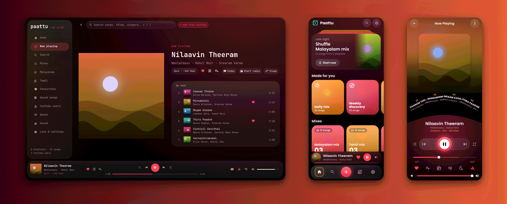
</p>

*Paattu* means "song" in both Malayalam and Tamil. It plays the public playlists of the YouTube
profiles you follow, and searches JioSaavn, YouTube and SoundCloud for anything else. The apps and
the Linux command share one library format: export it from one (Settings → Export the library, or
`~/.local/share/paattu/library.json`) and import it in another.

## Key Features

* **YouTube profiles and playlists** – paste a profile (a label, a composer, a friend) and every
  public playlist on it becomes a Paattu playlist; paste a playlist link for just that one.
* **Search everywhere** – JioSaavn (film albums, AAC up to 320 kbps), YouTube (Opus) and SoundCloud,
  with Songs / Albums / Artists / Playlists tabs, endless results and suggestions while you type, or
  paste a link to any site yt-dlp can play.
* **Favourites, Saved songs and your own playlists** – from every now-playing view; sync and
  refresh never touch them.
* **Mixes** – your own shuffle buttons made of languages, profiles and playlists; songs you play
  to the end join *Played in Malayalam / Tamil*, so the mixes grow as you listen.
* **Radio and playlists made for you** – song radio from YouTube Music, shaped by what you play
  and skip, auto radio when the queue runs out, Daily mix, Weekly discovery, Monthly top, and
  playlists from a description.
* **Charts** – the week's top songs, most searched and love songs for Malayalam, Tamil, Hindi,
  Telugu, Kannada and Punjabi, from JioSaavn and YouTube Music.
* **Now Playing with the song's video** – blurred, silent and in time behind the cover; four looks
  (cover, video first, full picture, record), colours from the cover, and the cover in 3D with its
  subject lifted out and moving with the song's rhythm.
* **Lyrics over the cover** – the line being sung pops out of the cover in 3D, filled with the
  cover's colours moving through it, with how it sounds in English letters under it (Malayalam,
  Tamil, Hindi, Telugu, Kannada); all the words in place of Up next, and a bar with the film, year,
  singers, language and plays.
* **Sound** – a fifteen-band equaliser (ISO 2/3-octave, each slider the level you get there) with presets (Melody, Kuthu, Bass boost, Late night…), preamp,
  bass, treble, balance and pitch-keeping speed, on every platform.
* **Fades and crossfades** – songs fade into each other; the app readies the next song 25 s early
  and downloads the next two in pieces.
* **Sleep timer** – minutes or *end of this song*, with an 8-second fade-out.
* **Songs kept on this device** – songs you play to the end are kept for playing offline
  (2 GB by default, least recently played go first), and take over when the internet goes.
* **Plays follow you (ListenBrainz)** – scrobbles carry your history between the phone, the
  desktop app and Omarchy, so made-for-you playlists follow you.
* **No ads, no third-party proxies** – streams come straight from the sites; Paattu never loads
  YouTube's player page and never scrapes mp3 download sites.
* **Omarchy-native** – a bar widget with a panel, a desktop widget on workspace 1 (vinyl, card or
  minimal), an app window, media keys and the lock screen through MPRIS, seven themes
  (Spicetify-style JSON files), and a `paattu` command for everything.
* **Updates from inside the app** – checked against each release's `SHA256SUMS.txt` before
  installing.

## Screenshots

The screenshots show a made-up library (songs, films and singers that don't exist) with drawn
covers.

**The app** (Android, Windows, Linux):

<table>
  <tr>
    <td align="center">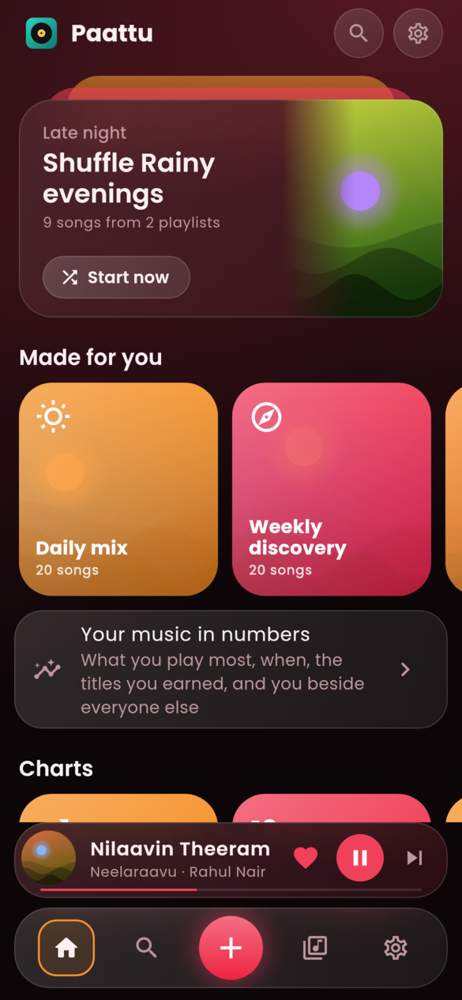<br><sub>Home</sub></td>
    <td align="center">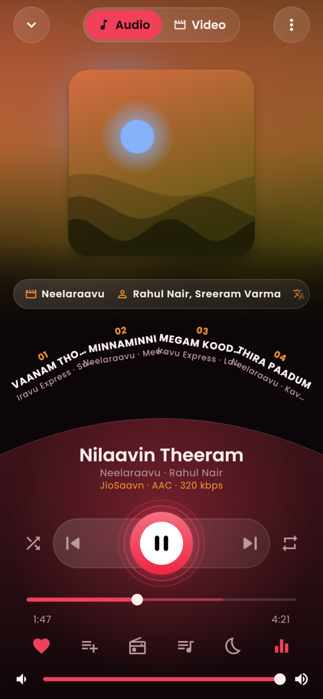<br><sub>Now Playing, upcoming songs on the arc</sub></td>
    <td align="center">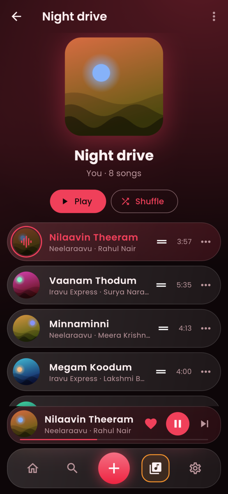<br><sub>Your playlist</sub></td>
    <td align="center">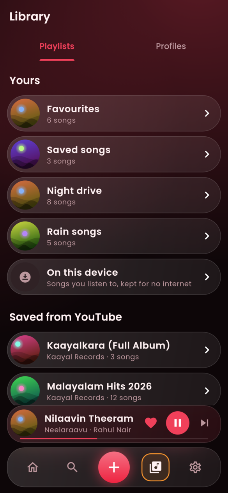<br><sub>Library</sub></td>
  </tr>
  <tr>
    <td align="center">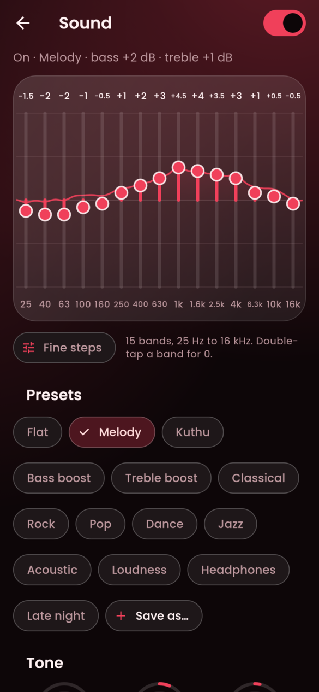<br><sub>Sound: equaliser and tone</sub></td>
    <td align="center">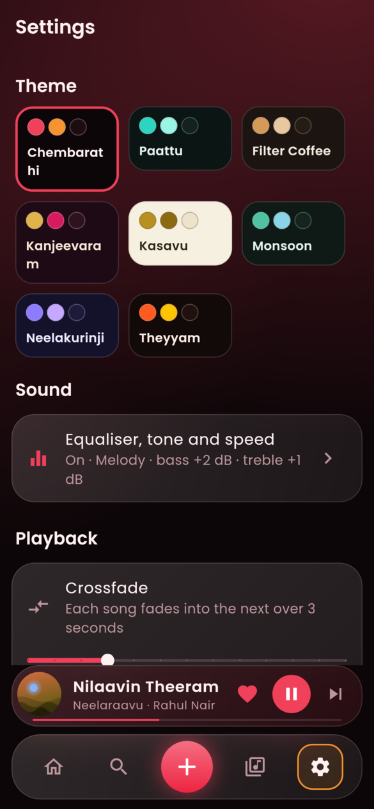<br><sub>Settings: the themes</sub></td>
    <td align="center">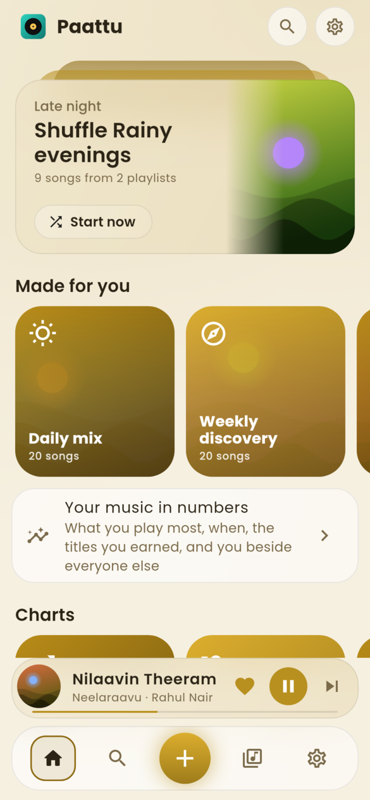<br><sub>Home (Kasavu, light)</sub></td>
    <td align="center">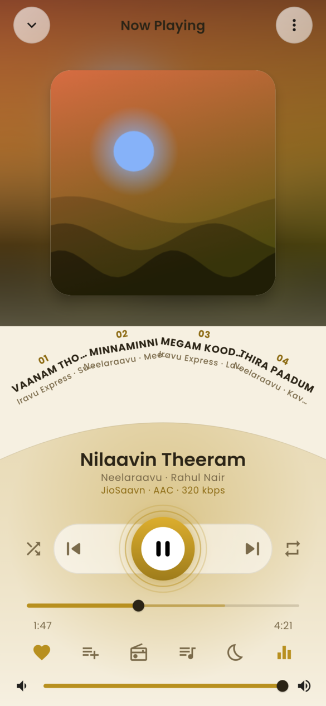<br><sub>Now Playing (Kasavu)</sub></td>
  </tr>
</table>

<table>
  <tr>
    <td align="center">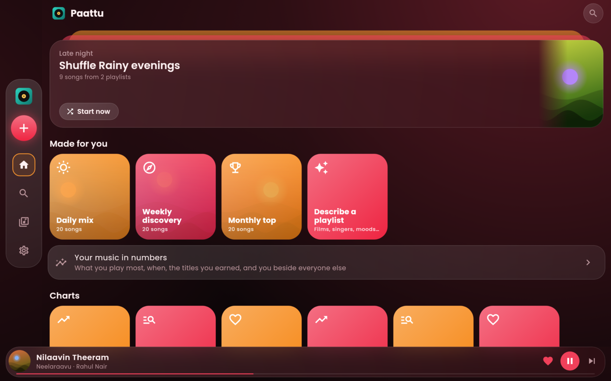<br><sub>Home on a desktop window</sub></td>
    <td align="center">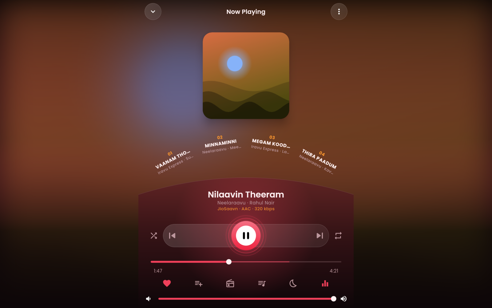<br><sub>Now Playing on a desktop window</sub></td>
  </tr>
</table>

**On Omarchy** (the app window and the desktop widget):

<table>
  <tr>
    <td align="center">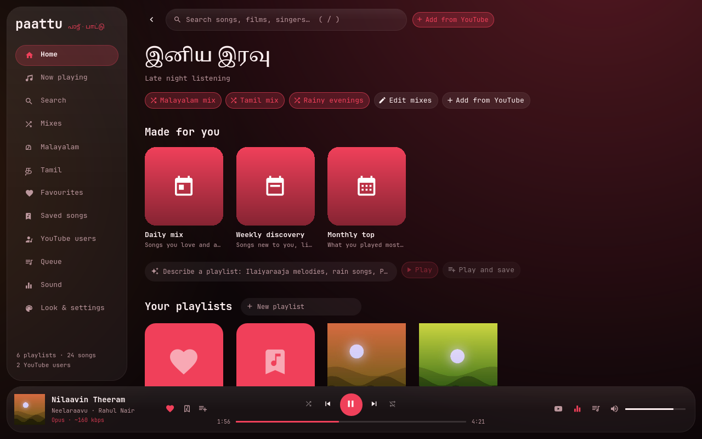<br><sub>Home</sub></td>
    <td align="center">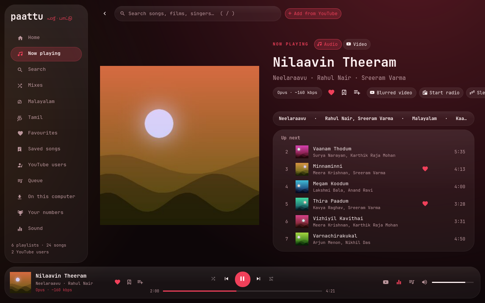<br><sub>Now playing and up next</sub></td>
  </tr>
  <tr>
    <td align="center">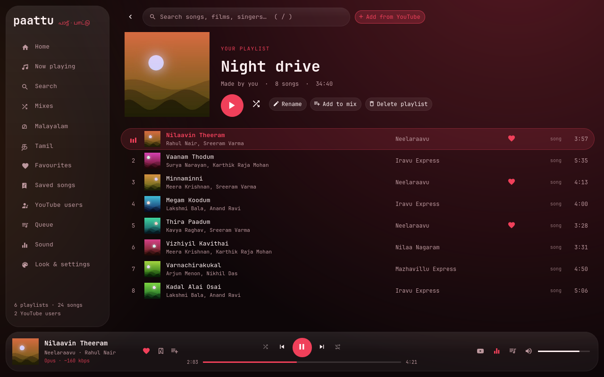<br><sub>A playlist</sub></td>
    <td align="center">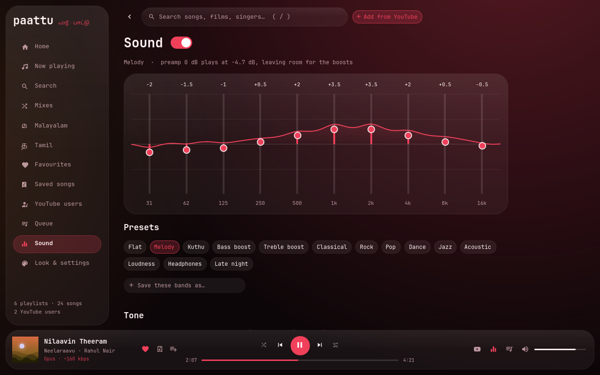<br><sub>Sound</sub></td>
  </tr>
  <tr>
    <td align="center">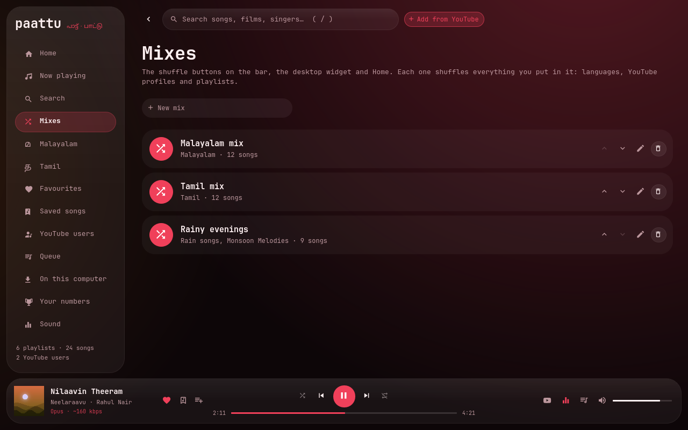<br><sub>Mixes</sub></td>
    <td align="center">
      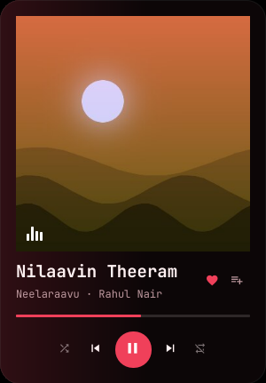
      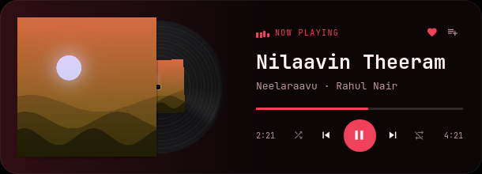<br>
      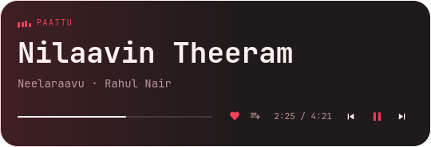<br>
      <sub>Desktop widget: card, vinyl, minimal</sub>
    </td>
  </tr>
</table>

## How To Use

| Where | What you get | Install |
|---|---|---|
| **Linux** (any distro) | the `paattu` command and music engine; on [Omarchy](https://omarchy.org) also a bar control, a desktop widget and an app window | `./install.sh` (below) |
| **Windows 11** | the Paattu app | `Paattu-…-windows-x64-setup.exe` from [Releases](../../releases) (or the portable zip) |
| **Android** | the Paattu app, with lock-screen and notification controls | `Paattu-…-android.apk` from [Releases](../../releases) |
| **Linux desktop app** | the same app as Windows / Android | `Paattu-…-linux-x86_64.AppImage` or the tarball from [Releases](../../releases) |

### Linux: the command and the Omarchy plugin

You'll need [Git](https://git-scm.com); `install.sh` brings the rest.

```bash
# Clone this repository
$ git clone https://github.com/sudharamachandranrajeev/paattu.git

# Go into the repository
$ cd paattu

# Install (asks once for sudo to install mpv and python)
$ ./install.sh

# What's installed
$ ./install.sh --check

# Only with OpenSnitch: let mpv / yt-dlp reach the music sites
$ sudo ~/.local/lib/paattu/install.sh --firewall

# Remove it (--purge also removes your library)
$ ./install.sh --uninstall
```

`install.sh` works on Arch (and Omarchy, Manjaro, EndeavourOS, CachyOS), Debian, Ubuntu (and Mint,
Pop!_OS), Fedora, openSUSE, Void and Alpine. It installs **mpv** (and mpv-mpris for media keys) and
**python3** with your package manager, a current **yt-dlp** (from pacman on Arch, otherwise the
official release into `~/.local/bin`, since distro packages are usually too old for YouTube) and
**deno** (yt-dlp needs a JavaScript runtime for YouTube), then the program into
`~/.local/lib/paattu`, the `paattu` command, and an mpv engine service for systemd users. Nothing
else runs as root. `--yes` answers its questions; `--dev` links your checkout instead of copying it
(for working on Paattu; the bar plugin is still a copy, so run it again after `git pull`). Without
systemd, `paattu` starts mpv itself.

On Omarchy, open it with **Super+Shift+M**, the music icon in the bar, the widget on workspace 1, or
Super+Space → Paattu. Elsewhere, use the command: `paattu search malare`,
`paattu play --lang Malayalam`, `paattu --help`.

### The apps

The apps search and play by themselves (no yt-dlp or mpv to install): JioSaavn songs at 320 kbps
AAC, YouTube's best audio (Opus), SoundCloud, and direct links to audio files. They have the same
library as the Linux command: Home with your mixes and shelves, Search, Library (your playlists,
YouTube profiles and playlists), Favourites, a queue and a now-playing screen, and the Paattu
themes.

Songs come from YouTube unless **Settings → Music from** says JioSaavn, SoundCloud or every site. A
song that won't play is tried another way, then as the same song on the other sites (best sound
first); if nothing works, the app says why in plain words and plays the next one. When something
goes wrong, **Settings → Problem log → Save the problem log** writes what the app tried and what
failed to a text file: attach it to an [issue](../../issues).

## Download

Download from [Releases](../../releases); each release also has `SHA256SUMS.txt`.

* **Windows** – `Paattu-…-windows-x64-setup.exe` (Inno Setup) or `…-windows-x64-portable.zip`. The
  installer is not code signed yet, so SmartScreen says "Windows protected your PC": choose **More
  info → Run anyway**.
* **Android** – `Paattu-…-android.apk`. Allow your browser or file manager to install unknown apps
  when asked.
* **Linux** – the AppImage brings its own mpv and uses your desktop's GTK 3 (`chmod +x` it and run
  it). The tarball (`…-linux-x64.tar.gz`) also needs mpv's library, libmpv.so.2 (`mpv` on Arch,
  `libmpv2` on Debian 12+ / Ubuntu 24.04+, `mpv-libs` on Fedora; on older systems use the AppImage).
* **Omarchy / any Linux, the command** – `./install.sh` from a clone (see [How To Use](#how-to-use)).

Once installed, the app finds new versions itself (see *Updates from inside the app* below).

## Feature Guide

Everything below works the same in the app (Android, Windows, Linux) and on Omarchy unless it says
otherwise; the `paattu` commands are for Linux.

<details>
<summary><b>How it works (Linux / Omarchy)</b></summary>

| Piece | What it is |
|---|---|
| `paattu` (Python, stdlib only) | library, YouTube lookups, search, playback commands — `paattu --help` |
| `paattu-engine.service` | headless **mpv** with a JSON IPC socket; resolves YouTube, JioSaavn, SoundCloud and other links through **yt-dlp** |
| `~/.config/omarchy/plugins/rajeevrama.paattu` | Omarchy shell plugin: bar widget + desktop widget + app window |
| `~/.local/share/paattu/library.json` | users, playlists, tracks (`shelf.json` is the small summary the bar reads) |
| `~/.cache/paattu/art/` | cover art, fetched by `paattu art` so the shell never touches the network |
| `~/.local/share/paattu/history.json` | what you played and for how long, behind the radio and the playlists made for you |
| `~/.config/paattu/mpv/scripts/paattu.lua` | the engine's script: notes each play, asks for more radio songs, fades, finds a dead stream elsewhere |

Choices, and why:

- **yt-dlp, not Piped.** yt-dlp runs locally and pulls the audio stream
  straight from YouTube, so no third-party instance sees what you play and
  there's nothing to go down.
- **No ads, without a browser.** Ads live in YouTube's player page; Paattu
  never loads it, so there's nothing to block. The video button opens Brave
  (the default browser) where Shields blocks the page's ads.
- **mpv as the engine.** mpv + yt-dlp is the most reliable YouTube audio path,
  and mpv-mpris makes media keys, the Omarchy OSD and the lock screen work
  for free. cliamp keeps its own role (see *cliamp* below).

</details>

<details>
<summary><b>YouTube profiles and their public playlists</b></summary>

Paste a YouTube profile (a label, a composer, a friend) and **every public
playlist on it** becomes a playlist in Paattu. Paste a playlist link and just
that one is added. In the app, use **Add from YouTube** (top bar, home page,
or the bar panel). From a terminal:

```
paattu import @Muzik247                   # a profile: all of its playlists
paattu import 'https://www.youtube.com/playlist?list=…' --lang Malayalam
paattu user list
paattu user sync                          # new playlists on followed profiles, fresh songs
```

Every profile also gets two automatic playlists: **Most played** (its popular
uploads) and **New releases**. Songs are fetched right away for profiles with
up to 40 playlists. Big labels have hundreds, so Paattu fetches the best 12
(hits, jukeboxes, recent movie albums) and loads the rest when you open or
play them. *Load songs for N playlists* on the profile page, or
`paattu user fetch @handle`, fetches them all at once. Profiles added this
way stay whole: `user sync` adds their new playlists too.

**Removing things**

- **A playlist:** the trash button on its row (profile page) or *Remove from
  app* on the playlist page. Click twice to confirm. It stays out of the app,
  even when the profile is synced again. *Bring back N removed playlists* on
  the profile page undoes it.
- **A song:** hover it in a playlist and click the trash button. Refreshing
  the playlist won't bring it back; *Bring back N removed songs* on the
  playlist page will.
- **A profile:** *Unfollow* on its page. A profile added whole goes with all
  of its playlists. For the optional starter library's profiles, the
  playlists you saved stay.

```
paattu playlist remove PL…                # one or more ids
paattu playlist restore [PL…] [--user @handle]
paattu playlist remove-songs PL… VIDEO…   # ids or watch links
paattu playlist restore-songs PL…
paattu user save-all @handle              # older profiles: add the playlists not saved yet
paattu user remove @handle
```

The optional starter library's profiles come with four saved playlists each.
*Add the other N playlists* on a profile's page adds the rest.

Video titles from the labels (`Song - Video Song | Movie | Composer | Label`)
are cleaned into song, movie and credits by `paattu/titles.py`.

**The optional starter library**

A new library is empty: add the profiles and playlists you want. If you'd
rather start with a ready-made South Indian library, `paattu seed` follows
27 verified channels (`paattu/seeds.py`) and saves about four playlists from
each:

- **Malayalam:** Muzik247, Saregama Malayalam, Sony Music Malayalam,
  Manorama Music Songs, Goodwill, East Coast, Satyam Audios,
  Millennium Audios, Magic Frames, Wonderwall, Mango Music, Friday Music,
  Think Music Malayalam, Sushin Shyam
- **Tamil:** Think Music, Sony Music South, Saregama Tamil, T-Series Tamil,
  Divo, Aditya Music Tamil, U1 Records, Lahari Music Tamil, Zee Music South,
  A. R. Rahman, Anirudh, Ilaiyaraaja, Sid Sriram

`paattu seed --remove` takes it out again: those profiles, the playlists they
brought and their cached cover art. Profiles and playlists you added, your
own playlists, Favourites and mixes stay. `paattu art --prune` clears cached
art for anything no longer in the library.

</details>

<details>
<summary><b>Favourites and your own playlists</b></summary>

Songs you want to keep go in **Favourites** or in playlists you make. Sync
and refresh never touch them, so a song stays there even after the YouTube
playlist it came from drops it or you remove that playlist.

- **Heart** a song to add it to Favourites (click again to take it out).
- **Save** (the bookmark) keeps it in **Saved songs**, your library of
  songs found by searching. Like Favourites it's always there and can't be
  renamed or deleted.
- **Add to playlist** (the list-plus button) ticks the playlists the song
  is in. Click one to add or remove it, or type a name to start a new one.

Both buttons are on every now-playing view: the app's bottom bar, the bar
panel and all three desktop styles. In the app they're also on every song
row (hover a row; hearted songs keep their heart showing). The desktop widget
can't take typing, so its *New playlist…* opens the app's picker.

Favourites sits in the sidebar; your playlists are on Home under *Your
playlists*, where you can also start a new one. Their pages can rename and
delete them (Favourites can't be deleted).

```
paattu fav                              # heart the song that's playing
paattu fav VIDEO… | --remove | --toggle | --list
paattu save [SONG…] | --remove | --toggle | --list   # Saved songs
paattu play saved
paattu playlist new "Night drive" [VIDEO…] [--now]
paattu playlist add-songs "Night drive" [VIDEO…]   # default: the song that's playing
paattu playlist remove-songs "Night drive" VIDEO…
paattu playlist rename "Night drive" "Rain songs"
paattu playlist remove "Rain songs"     # deletes it
paattu play favourites                  # or the name of any playlist you made
```

A song from outside the library (a watch link) gets its title from yt-dlp.
Your playlists live in `library.json` next to the saved ones (`local: true`,
ids `paattu-…`; Favourites is `paattu-favourites`) and appear in `shelf.json`
under `mine` for the bar and the desktop widget.

</details>

<details>
<summary><b>Search: new songs from YouTube, JioSaavn, SoundCloud or a link</b></summary>

The search box at the top of the app and of the bar panel (press `/` in
either) looks beyond your library. Type a song, a film or a singer and press
**Enter** to search where the music comes from: YouTube unless *Look &
settings → Music from* (the apps: *Settings → Music from*) picks another
site or all three. Albums come from JioSaavn and SoundCloud whichever you
pick.

| Site | What it has | Plays at |
|---|---|---|
| **JioSaavn** | the labels' film albums | AAC, up to 320 kbps |
| **YouTube** | everything else: lyric videos, old film songs, live shows | Opus, about 130–160 kbps |
| **SoundCloud** | covers, remixes, independent artists | whatever the uploader gave |

Or **paste a link** to a song, album or playlist on any site yt-dlp can play:
JioSaavn, YouTube, SoundCloud, Bandcamp, Audiomack, archive.org, or a plain
mp3 / m4a / flac file. A FLAC link plays lossless.

While you type, suggestions come up: YouTube's search phrases, and
JioSaavn songs, albums, singers and playlists that open straight away. After
**Enter**, the tabs switch between **Songs**, **Albums**, **Artists** and
**Playlists**; each loads more as you scroll down, and the same film song
from two sites shows once (the 320 kbps JioSaavn copy). An album or playlist
opens on its own page to play, shuffle, save or open on its site. A
JioSaavn artist's page has their songs (more as you scroll), albums and
singles, playlists and similar singers; a YouTube channel's has its popular
uploads and playlists, and **Follow** adds it to YouTube users.

Click a result to play it. Hover it for its buttons: heart (Favourites),
save (Saved songs), add to any of your playlists or a new one, and play
next. In the app, typing filters your library as before and the online
results sit above it, without saying which site each is from. In the bar
panel, *All N in Paattu* opens the same search in the app.

Every now-playing view shows what mpv is decoding: *AAC · 320 kbps* from
the stream's own bit rate, or *Opus · ~130 kbps* measured when the site
doesn't say. Paattu streams; it doesn't download, and it doesn't scrape mp3
download sites.

```
paattu search kaathalae kaathalae               # where the music comes from (search.sites)
paattu search --site jiosaavn --limit 20 malare
paattu search 'https://www.jiosaavn.com/album/…'   # what's at a link
paattu browse search --kind album chithra       # songs, albums, artists or playlists, a page at a time
paattu browse search --kind song --after '{"youtube": "…"}' chithra   # the next page
paattu browse suggest chith                     # what the search box suggests
paattu browse open '{"type": "artist", "site": "jiosaavn", "id": "455", …}'   # an item from browse search
paattu play SONG                                # an id from a search, or any song link
paattu add [--next] SONG
paattu save SONG | paattu fav SONG
paattu playlist add-songs "Night drive" SONG
```

Songs from other sites get ids made from their page address
(`jiosaavn.com_song_kaathalae-kaathalae-from-96_QyVdYxxAZgM`). The last 400
search results are remembered in `~/.cache/paattu/search.json`, so their ids
work after the search. A song you save, heart or add to a playlist is copied
into `library.json`. Search settings are in `paattu config`:
`search.sites` (`["youtube"]`, or any of jiosaavn, youtube, soundcloud) and
`search.limit`.

</details>

<details>
<summary><b>Mixes (the shuffle buttons)</b></summary>

The shuffle buttons on the bar panel, the desktop widget and Home are
**mixes**, and you choose what goes in them. A new library starts with none:
*Make a mix* on Home (or **Mixes** in the sidebar) makes one, and you can
rename, change, reorder or delete them and add as many as you like. Songs you
play to the end (90% of them, or all but the last 20 seconds), from anywhere,
go into *Played in Malayalam* or *Played in Tamil* (by the song's language),
playlists you can put in a mix, so it grows as you listen. A mix shuffles
everything in it:

- **a language:** every saved playlist in that language, including ones
  saved later
- **a YouTube profile:** every saved playlist of that profile, including new
  ones that `user sync` adds
- **a playlist:** that one playlist, saved or one of yours (Favourites and
  Saved songs too)

In the app, **Mixes** in the sidebar lists them in button order. Use the
arrows to reorder, the pencil to change one, the trash to delete, or type a
name to make a new one. A mix's page has two parts: *In this mix* (click a
source to take it out) and *Add to this mix*, which lists every language,
profile and playlist with a filter box. **Add to mix** on a profile, playlist
or language page puts that one into any mix, or starts a new mix with it.
*Edit mixes* on the bar panel and on Home opens the list. In the bar panel,
keys 1–9 start mix 1–9. With nothing playing, middle-clicking the bar icon
starts the first mix.

```
paattu mix list
paattu mix new "Night drive" --user @Muzik247 --playlist favourites
paattu mix add "Night drive" --lang Tamil --playlist 'https://www.youtube.com/playlist?list=…'
paattu mix drop "Night drive" --lang Tamil
paattu mix rename "Night drive" "Kollywood"
paattu mix move "Night drive" 1         # its place among the buttons, from 1
paattu mix remove Kollywood
paattu mix fetch "Night drive"          # load songs for its playlists that don't have them yet
paattu play --mix "Night drive"         # what the button does
```

Mixes live in `library.json` under `mixes` (list order is button order) and
in `shelf.json` with their counts. When you remove a playlist or unfollow a
profile, it also leaves every mix it was in. Starting a mix whose playlists
have no songs loaded yet loads a few first. Playlists you picked one by one
always load. *Load songs for N playlists* on the mix page loads the rest.
A mix you delete stays deleted. Libraries from before 0.12 started with a
*Malayalam mix* and a *Tamil mix*; 0.12 takes those away unless you changed
them.

</details>

<details>
<summary><b>Playing, Now Playing looks and the cover in 3D</b></summary>

```
paattu play --mix "Night drive"         # a shuffle button (see Mixes)
paattu play --lang Malayalam            # shuffled mix of the saved Malayalam playlists
paattu play PL… [--shuffle] [--index 3]
paattu play --user @ARRahman
paattu toggle | next | prev | seek +10 | volume 60 | shuffle | repeat
paattu status | queue | jump 5
paattu watch                            # this song's video in Brave, audio pauses
paattu video SONG                       # where to stream its small, silent video
paattu depth SONG                       # its cover's subject, cut out for the cover in 3D
paattu rhythm SONG                      # its loudness and beats (the cover in 3D moves with them)
```

Now Playing (in the app, and on Omarchy from the sidebar or by clicking the
song in the player bar) shows the song's video behind it, blurred, silent
and kept in time with the music: the smallest H.264 picture, about 1 MB a
minute. A YouTube Music song whose own video is only its cover held still
(an "art track"), and JioSaavn and SoundCloud songs, use a YouTube video of
about the same length found by search (a lyric or video song) when there is
one. On Omarchy it needs Qt Multimedia (`qt6-multimedia-ffmpeg`); turn it off
with `paattu config set videoBackground false` or in *Look & settings*.

Settings › Now Playing chooses how it looks, the same in the app (Android,
Windows, Linux) and on Omarchy:

- **Cover** (the default): the cover stays, and the video plays blurred
  behind it.
- **Video first**: the cover fades away while the video plays.
- **Full picture**: the cover (or the video) fills the whole page, sharp,
  with the song's details over it.
- **Record**: the cover is the label of a turning record.

**Video blur** sets how soft the video is, from none to 100 (30 by default).
**Cover colours** gives Now Playing and the player bar the colours of the
song's cover, changing slowly from one song to the next and keeping the
theme dark or light. **Cover in 3D** (on by default) tilts the cover towards
the pointer (on a phone, as you tilt it), drifting slowly when nothing moves
it, and lifts the people in it out of the picture with a soft shadow behind
them. The subject is found on the device: by ML Kit on Android, and by
U²-Net's small model (`models/u2netp.onnx`, with ONNX Runtime) on Windows,
Linux and Omarchy. On Omarchy, `paattu depth` runs it through
[uv](https://docs.astral.sh/uv/), which fetches ONNX Runtime, NumPy and
Pillow (and Python 3.12 if needed) the first time: about 35 MB to download,
about 100 MB in uv's cache. Without uv the cover only tilts. Each cover's
cut-out is kept in `~/.cache/paattu/depth/`.

The queue skips trailers and plays each song once even when a playlist has
both the video and the lyrical upload.

**About the song** (Settings › Now Playing, on by default) puts a bar just
above Up next: the film and year, the singers and composer, the language, the
label, the stream's quality, the site, its plays on the site and, in the app,
how many times you've played it.

</details>

<details>
<summary><b>Lyrics</b></summary>

When the song's words can be found, the line being sung shows over the top
of the cover on Now Playing, with how it sounds in English letters under it
(for Malayalam, Tamil, Hindi, Telugu and Kannada). The **Lyrics** button
shows all the words in place of Up next, the line being sung lit up.

The words come from [LRCLIB](https://lrclib.net) (in the song's own script,
timed to the song) or, when it has none, YouTube Music (the words without
timing; then only the Lyrics button shows them). The English letters are
worked out on the device from the script. What was found is kept for each
song, and a song with no words is asked about again after three days.

Settings › Lyrics:

- **Over the cover** shows the line being sung (on by default).
- **Each line** comes in **popping out in 3D** (the default), **fading in**,
  or **plain**.
- **Cover's colours** fills the words with the cover's colours, moving slowly
  through them; off, they're one colour.
- **English letters** shows how each line sounds under it.

On Omarchy, `paattu lyrics [id]` prints the words of a song (the one playing
when no id is given) with their times; `--refresh` asks again.

</details>

<details>
<summary><b>Sleep timer</b></summary>

The moon button on Now Playing stops the music by itself:

- a while from now — 5, 10, 15, 30, 45, 60 or 90 minutes;
- **End of this song**, which waits for the song playing to finish rather
  than cutting it off;
- **+5 min** to add to a countdown that's running, or *Turn off*.

When it's up Paattu quiets the song over 8 seconds and pauses, so nothing
stops mid-word. The queue stays where it is: press play in the morning and
it carries on from that song. Pressing play *during* the fade-out cancels it
and comes back to full volume. A song you skip doesn't end an *End of this
song* timer — you're still listening.

On Omarchy the **Sleep** chip on Now Playing goes 15, 30, 60 minutes, end of
this song, off with each press, and the command does the same:

```
paattu sleep 30      # pause in 30 minutes (8 s fade-out first)
paattu sleep +5      # 5 more minutes
paattu sleep end     # pause when this song finishes
paattu sleep off
paattu sleep         # what's set
```

The engine script (`engine/paattu.lua`) keeps the timer, so it runs whether
or not the bar is open. Pausing during the fade-out ends it.

</details>

<details>
<summary><b>Songs kept on this device</b></summary>

A song you play to the end (90% of it, or all but the last 20 seconds) is
kept in a folder, so it plays later with no internet and no data. The library
builds itself out of what you listen to, rather than out of what you remember
to download. A song you skip the first time it plays isn't kept, and the
radio and the playlists made for you leave it out from then on.

When a song won't play because the internet has gone, Paattu plays the songs
kept here instead, shuffled (the app first tries the next kept song in the
queue).

- **Home › On this device** (the app) and **Home › On this computer**
  (Omarchy) play or shuffle them and show the newest; *See all* opens the
  list, which also takes a song off again.
- A song's menu has **Keep on this device**, for one you want now whether or
  not you've played it. The same menu takes it off.
- **Settings › On this device** turns the automatic keeping off, moves the
  folder, and sets the room allowed: **2 GB by default**, and past it the
  songs played *least recently* go first, so what you still listen to stays.
  On Omarchy the *On this computer* page has the same switches.

On Omarchy yt-dlp downloads them into `~/.local/share/paattu/offline`, and the
engine plays the file in place of the stream:

```
paattu offline                          # what's kept, and the room it takes
paattu offline keep current             # keep the song playing (or a link or id)
paattu offline drop SONG
paattu offline play [--shuffle]
paattu config set offline.autoSave false
paattu config set offline.limitMb 5120  # 0: no limit
paattu config set offline.dir ~/Music/Paattu
```

The files are named `Singer - Song.m4a` (or `.webm` for Opus, `.flac`,
`.mp3`), so the folder reads like a music collection to anything else that
opens it, and it carries its own index (`paattu-offline.json`) so the whole
folder can be moved or copied to another device. You can point it at any
folder you like (on Android, Paattu first asks for "All files access", which
writing outside its own folder needs; the phone's Music folder or an SD card
work).

Two things worth knowing:

- Kept songs aren't kept while **Save data** is on — pulling whole songs down
  is exactly what that setting avoids. Turn Save data off and keeping starts.
- A kept song plays from its file, so it needs no stream link and works
  offline. If a kept file turns out to be broken, Paattu forgets it and
  streams the song instead, rather than failing on it.

</details>

<details>
<summary><b>Updates</b></summary>

**Settings › About › Check for updates** reads the [Releases](../../releases)
on GitHub, shows what's new in the version it found, then downloads the right
file for this device, checks its SHA-256 against the release's
`SHA256SUMS.txt`, and installs it:

| Where | What installing does |
|---|---|
| **Android** | hands the APK to the system's installer (allow "install unknown apps" when asked) |
| **Windows** | runs the setup program; Paattu closes so it can be replaced, and setup offers to start the new one |
| **Linux AppImage** | replaces the AppImage where it stands — open Paattu again to use the new one |
| **Linux tarball** | saves the AppImage to Downloads and says where, since Paattu can't replace an installed folder safely |

Each time the app starts it looks for a newer version by itself and, when
there is one, asks whether to install it (*Not now* leaves it in Settings). A download that doesn't match its checksum is thrown away, and
a release that publishes no checksum isn't installed at all — you can always
get it from the releases page instead.

On Omarchy the Paattu window asks the same way when it opens. *Update* pulls
a `--dev` checkout and runs its `install.sh --dev`, or downloads the release
and runs its `install.sh`; then *Restart the shell* loads the new window.

```
paattu update                           # is there a newer one?
paattu update apply                     # install it
```

**The repository has to be public for the app to see its releases.** GitHub
answers 404 to everybody else about a private one, so while it's private,
*Check for updates* reports that it couldn't reach the releases.

</details>

<details>
<summary><b>Radio and playlists made for you</b></summary>

```
paattu radio start [SONG]               # songs like SONG (or the one playing), without end
paattu radio stop                       # the radio's songs still to come go
paattu made                             # Daily mix, Weekly discovery, Monthly top
paattu made daily --play [--refresh]    # play today's (--refresh: a new one)
paattu describe "Ilaiyaraaja melodies, rain songs, Premam" --play [--save NAME]
paattu charts                           # the charts for your languages
paattu charts top Malayalam --play      # top / searched / love, then the language
paattu config set fade 3                # seconds a song fades out and the next in (0: off)
paattu config set autoRadio false       # don't carry on when the queue runs out
```

**Radio** (the *Start radio* button on Now Playing, in the app and on
Omarchy) plays songs like a song, from YouTube Music's own radio for it, a
helping at a time as the queue runs low. Like Spotify's and YouTube's, it
leaves out what you played in the last six hours and songs you skipped more
than once, and when one song's radio runs dry it carries on from a song it
played. With **auto radio** on (the default), any queue that runs out
carries on as a radio of its last song, unless repeat is on or you turned
the radio off. What you play shapes it: songs by the singers and composers,
and from the films, you play to the end come first, ones you skip drop back,
and a couple of your own favourites like the station's song join it.

**Made for you** (on Home) comes from what you play: how long you listened
(a play counts after half a song or 30 seconds), how often, how lately
(a play is worth half as much a week later), your Favourites and Saved
songs, and what you skip.
- **Daily mix**: songs you love, two at a time, then one like them that's
  new to you. A new one every day.
- **Weekly discovery**: only songs you haven't played, from the radios of
  the songs you like most. A new one every Monday.
- **Monthly top**: what you played most in the last 30 days.
- **Charts**: the week's *Top* (JioSaavn's weekly top 50 and, where it has
  one, YouTube Music's top weekly videos, taken in turn), *Most searched* and
  *Love songs* for each of your languages (Settings › Charts in the app).
  Fetched again every 12 hours, without the songs you turned down.
- **Describe a playlist**: "songs from Premam, rain songs and Ilaiyaraaja"
  looks up each part and takes their songs in turn, topped up from each
  part's radio.

**Fades**: each song fades out over its last seconds and the next fades in
(3 seconds by default; *Look & settings → Between songs* on Omarchy,
*Settings → Playback* in the app). In the app the next song is ready 25
seconds early and the two overlap (a true crossfade), and the next two songs
download in pieces while one plays, so a slow stream doesn't stop the music.
On Omarchy mpv plays one song at a time, so the fade out and the fade in
come one after the other rather than overlapping.

</details>

<details>
<summary><b>Sync plays between devices (ListenBrainz)</b></summary>

```
paattu listenbrainz login     # asks for your user token (listenbrainz.org/settings)
paattu listenbrainz sync      # send new plays, read the other devices' in
paattu listenbrainz status
paattu listenbrainz logout
```

Each song heard properly is scrobbled with the song in the listen's
`additional_info`, and the plays other Paattu installs (the app on Android,
Windows and Linux, and this one) scrobbled come back into
`~/.local/share/paattu/history.json`. Made-for-you playlists and the *Played
in ...* playlists are made from that history, so they follow you. Your
listening history on ListenBrainz is public. Playlists and favourites don't
sync this way (ListenBrainz playlists need MusicBrainz IDs); use the library
export and import for them.

</details>

<details>
<summary><b>Sound: equaliser, tone, balance and speed</b></summary>

A fifteen-band equaliser (the ISO 2/3-octave bands: 25, 40, 63, 100, 160,
250, 400, 630 Hz, 1, 1.6, 2.5, 4, 6.3, 10 and 16 kHz, ±12 dB) with presets
(Melody, Kuthu, Bass boost, Rock, Late night and more, plus your own), a
preamp, bass and treble, left / right balance, and speed that keeps the
pitch. "Keep loud songs from clipping" (on by default) lowers the preamp by
the biggest boost, so a bass boost doesn't distort.

Each slider is the level the sound gets at its band, to within about half a
dB. Neighbouring band filters overlap, so setting each filter to its slider
would pile up (fifteen bands at +12 dB would give about +22 dB) and one band
would lift its neighbours. Paattu works out the filters' own gains instead:
it measures how each filter reaches the band centres and the points between,
and solves for the gains by least squares, twice (Välimäki and Liski's
*accurate cascade graphic equaliser*). The curve drawn behind the sliders is
what you hear. For fine tuning, hold Shift (or turn on *Fine steps* in the
app): the slider moves in tenths of a dB, a quarter as fast, from where it is.

Settings from before 0.14 had ten bands. They become the fifteen levels
those ten filters gave, so the sound stays as it was; the built-in presets
were carried over the same way.

- **Omarchy**: the Sound page in the Paattu window (the equaliser button on
  the now-playing bar opens it). Drag a slider or knob, scroll over it, or
  double-click it to put it back; you hear it while you drag.
- **Windows and the Linux app**: Settings → Sound, or the equaliser button
  on Now playing. Same controls and presets.
- **Android**: the same page, played through the phone's own equaliser
  and loudness enhancer. That equaliser usually has five bands, so the
  fifteen-band curve is matched at those five. There's no balance on Android.

```
paattu sound                              # what's on
paattu sound presets
paattu sound preset melody                # turns the equaliser on
paattu sound set --band 1k=+2 --band 1.6k=+1.5 --band 25=-1 --bass 3 --treble -1
paattu sound set --preamp -2 --balance -0.2 --speed 1.25 --noclip on
paattu sound save "Car"                   # keep the bands as your preset
paattu sound delete "Car"
paattu sound off | on | reset
```

Everything is one chain of FFmpeg `equalizer` filters in mpv, the only
audio filter the Windows libmpv has; the desktop engine and the Windows /
Linux app build the same chain from the same numbers
(`tests/sound_cases.json`).

</details>

<details>
<summary><b>Customising (Spicetify-style themes, desktop widget, bar)</b></summary>

Everything is a file that applies live, and everything can be set from the
command line:

```
paattu theme list
paattu theme set kanjeevaram            # or: omarchy (follows your Omarchy theme)
paattu config set desktop.style card    # vinyl | card | minimal
paattu config set desktop.position top-right
paattu config set desktop.workspace 1
paattu config set desktop.scale 1.2
paattu config set desktop.opacity 0.8
paattu config set videoBackground false # no video behind Now Playing
paattu config set nowPlayingStyle record  # cover | video | full | record
paattu config set videoBlur 50          # 0 (sharp) to 100
paattu config set coverColors true      # Now Playing in the cover's colours
paattu config set coverDepth false      # a flat cover in Now Playing
paattu config set songInfo false        # no bar about the song above Up next
paattu config set lyrics.show false     # no words over the cover
paattu config set lyrics.effect fade    # 3d | fade | plain
paattu config set lyrics.gradient false # the words in one colour
paattu config set lyrics.transliterate false  # no English letters under them
```

- **Themes** are JSON files in `~/.config/paattu/themes/` (`background`,
  `surface`, `foreground`, `muted`, `accent`, `highlight`). Seven ship with
  it: Kasavu, Kanjeevaram, Monsoon, Neelakurinji, Filter Coffee, Theyyam,
  Chembarathi.
  Copy one, edit the colours, and it appears in *Look & settings*.
- **Desktop widget:** right-click it to cycle styles, scroll for volume,
  middle-click to open the app. Hover for style / video / open buttons.
- **Bar widget:** label on/off, label width and scroll behaviour are in
  Omarchy's bar settings (or `omarchy bar set rajeevrama.paattu label none`).
  Click opens the panel, middle-click plays/pauses (or starts the first mix),
  right-click skips. In the panel, 1–9 start your mixes.

</details>

<details>
<summary><b>cliamp</b></summary>

cliamp (Super+Shift+Alt+M) is a good terminal player and it was evaluated
as the engine. Its daemon mode, v2 IPC, EQ and spectrum stream are all
usable from a shell plugin, but only one cliamp instance can run per user,
so a cliamp engine would lock you out of cliamp's own TUI. Paattu keeps mpv
as the engine and shares the library instead:

```
paattu export cliamp      # every saved playlist → ~/.config/cliamp/playlists/Paattu - *.toml
```

cliamp then plays the same Malayalam / Tamil library with its Winamp EQ and
visualizer. Features worth bringing over next, natively: the spectrum visualizer (cava), Radio Browser
stations (cliamp's history already has Anbu FM Malayalam, BIG 92.7, Big FM
Tamil), and synced lyrics (LRCLIB).

</details>

<details>
<summary><b>Firewall (OpenSnitch)</b></summary>

OpenSnitch asks before a new program connects, and an unanswered prompt
becomes a permanent block after 30 seconds. `sudo ./install.sh --firewall`
adds one rule letting mpv and python (yt-dlp) reach only the music sites:
YouTube, JioSaavn and SoundCloud for search, plus Bandcamp, archive.org and
Audiomack for links. A link to any other site gets an OpenSnitch prompt the
first time. It also offers to remove the old rule that blocks cliamp.
`paattu play` warns (desktop notification) when the rule is missing. If you
added the rule before search existed, run it again to add the new sites.

</details>

<details>
<summary><b>Roadmap (one feature at a time)</b></summary>

1. ✅ YouTube profiles (all their playlists) and playlist links; remove /
   restore playlists and songs; South Indian library
2. ✅ Favourites and your own playlists, from every now-playing view
3. ✅ Mixes: your own shuffle buttons (languages, profiles, playlists);
   starter library made optional
4. ✅ Search JioSaavn, YouTube and SoundCloud from the app and the bar; play
   or keep a song from any link; Saved songs; stream quality on now playing
5. ✅ Albums, artists and playlists in search, endless results, suggestions
   while typing; faster YouTube in the app
6. ✅ Sound: a fifteen-band equaliser with presets, preamp, bass, treble,
   balance and speed, on Omarchy, Windows, Linux and Android
7. ✅ A new look, and the song's video softly blurred behind Now playing
8. ✅ Song radio, auto radio, Daily / Weekly / Monthly playlists, playlists
   from a description, fades between songs and songs downloaded ahead
9. A real spectrum visualizer on the widgets
10. Malayalam / Tamil radio stations (Radio Browser)
11. ✅ Synced lyrics over the cover, with English letters, in the app and on
    Omarchy
12. ✅ Now Playing looks (cover, video first, full picture, record), video
    blur, the cover's colours and the cover in 3D, with Windows media
    controls
13. ✅ Sleep timer, songs kept on this device as you listen to them, and
    updates from inside the app (the sleep timer on Omarchy too)
14. The kept songs on the `paattu` command and the Omarchy plugin, so the
    desktop player has them too

</details>

## Development

```bash
# The Python CLI and the plugin's Model.js
$ python3 -m unittest discover -s tests     # titles, library, search, seeds, cliamp export, config
$ node --test tests/*.test.mjs              # the plugin's Model.js

# Use this checkout as the installed program
$ ./install.sh --dev

# The app (Flutter 3.47)
$ cd app && flutter pub get && flutter test && flutter run

# README screenshots: the app (real fonts, a made-up library, drawn covers) ...
$ cd app && PAATTU_SHOTS=/tmp/shots flutter test test/screenshots_test.dart

# ... and the Omarchy plugin, drawn offscreen with a private silent mpv
$ tools/omarchy-screenshots/run.sh /tmp/shots-omarchy
```

<details>
<summary><b>The app's code, CI and releases</b></summary>

The app is in `app/` (Flutter, Dart): `lib/src/` has the library model
(a port of `paattu/library.py`), title cleaning (`titles.py`), the sources
(JioSaavn, YouTube via youtube_explode_dart, SoundCloud) and the player
(just_audio: ExoPlayer on Android, libmpv on Windows / Linux, with
audio_service for Android's media controls). Now Playing's silent video is
video_player on Android and media_kit_video on Windows / Linux. `lib/src/ui/`
holds the glass look (`glass.dart`). `subject.dart` finds the cover's subject
(ML Kit on Android, U²-Net with ONNX Runtime on Windows / Linux, from
`packages/flutter_onnxruntime`). `player/sleep_timer.dart` is the sleep timer,
`offline.dart` the songs kept on this device, and `update.dart` the in-app
updater (GitHub's releases, checked by SHA-256 before anything is installed;
Android's half of it is the `installApk` method channel in `MainActivity.kt`,
which hands the APK to the system's installer through a FileProvider).
`app/test/` runs the same title, track-id and subject-mask cases as `tests/`,
plus the sleep timer, the offline library and the updater's version and
checksum reading. `app/test/screenshots_test.dart` renders the README's app
screenshots and is skipped unless `PAATTU_SHOTS` names an output folder.

GitHub Actions does the rest: `ci.yml` runs every test, shellcheck, and
`install.sh` on Debian, Ubuntu, Fedora, Arch and openSUSE containers;
`release.yml` builds the signed APK, the Windows installer (Inno Setup) and
the Linux AppImage and tarball, starts each one (the installer on Windows, an
Android emulator, Ubuntu, Fedora and Arch containers), and on a `v*` tag
publishes them as a release. The Android signing key is in the repository secrets
(`PAATTU_KEYSTORE_BASE64`, `PAATTU_KEYSTORE_PASSWORD`, `PAATTU_KEY_ALIAS`,
`PAATTU_KEY_PASSWORD`); without them the APK is signed with a debug key.

The shell plugin hot-reloads, except `Home.qml` (the always-loaded desktop
widget / window host), which needs `omarchy restart shell`.

</details>

<details>
<summary><b>Five rules learned the hard way</b></summary>

- **Never bind `layer.enabled` to an Image's status** (`Cover.qml`). When a
  window first gets the screen's scale (1.5× here), Qt walks the item tree
  and reloads images. If an image drops out of `Ready`, the layer turns off
  and deletes its effect items while Qt is still walking them, and the whole
  shell aborts ("pure virtual method called").
- **Don't write a whole queue to mpv before reading its replies**
  (`engine.py`). mpv stops reading a client whose replies it can't send, so a
  mix of thousands of songs deadlocked and timed out. `Engine.batch` sends
  in chunks of 200 and reads as it goes. `tests/test_library.py` checks this
  against a real mpv.
- **YouTube ids can start with `-`** (66 songs in the library do), and
  argparse reads those as options. Pass ids to the CLI as `--track=ID` or
  after `--` (`Model.js` builds them that way; `tests/model.test.mjs` checks).
- **A Quickshell `Socket` is good for one connection** (`Player.qml`,
  Quickshell 0.3.1). Once a connect fails, setting `connected` or `path`
  again does nothing, so a shell started before the engine never saw it
  start and the UI stopped following playback. One that connects while mpv
  is quitting reports an error but stays "connected". Each attempt makes a
  fresh Socket, and any Socket that reports an error is thrown away.
- **A row's MouseArea goes under its buttons** (`z: -1`). A MouseArea that
  fills the row and comes after the buttons in the file gets their clicks,
  so the heart played the song instead.

Track ids for other sites are made in two places, `sources.track_id` and
`Model.trackId`; `tests/track_ids.json` holds the cases both suites check.

</details>

## Credits

This software uses the following open source packages and services:

- [mpv](https://mpv.io), [mpv-mpris](https://github.com/hoyon/mpv-mpris), [yt-dlp](https://github.com/yt-dlp/yt-dlp) and [Deno](https://deno.com) – the Linux engine
- [Quickshell](https://quickshell.org) and [Omarchy](https://omarchy.org) – the bar, desktop widget and app window
- [Flutter](https://flutter.dev), [just_audio](https://pub.dev/packages/just_audio), [audio_service](https://pub.dev/packages/audio_service) (+ [audio_service_win](https://pub.dev/packages/audio_service_win)), [audio_session](https://pub.dev/packages/audio_session), [media_kit](https://github.com/media-kit/media-kit) (+ just_audio_media_kit, media_kit_video), [video_player](https://pub.dev/packages/video_player), [youtube_explode_dart](https://pub.dev/packages/youtube_explode_dart), [rxdart](https://pub.dev/packages/rxdart), [file_picker](https://pub.dev/packages/file_picker), [sensors_plus](https://pub.dev/packages/sensors_plus), [package_info_plus](https://pub.dev/packages/package_info_plus) – the app
- [ML Kit subject segmentation](https://pub.dev/packages/google_mlkit_subject_segmentation), [ONNX Runtime](https://onnxruntime.ai) (+ flutter_onnxruntime) and [U²-Net](https://github.com/xuebinqin/U-2-Net)'s small model, run through [uv](https://docs.astral.sh/uv/) on Omarchy – the cover in 3D
- [Poppins](https://fonts.google.com/specimen/Poppins) (SIL Open Font License) – the app's font
- [JioSaavn](https://www.jiosaavn.com), [YouTube](https://www.youtube.com) / YouTube Music, [SoundCloud](https://soundcloud.com) – where the music comes from; [ListenBrainz](https://listenbrainz.org) – plays across devices
- [Inno Setup](https://jrsoftware.org/isinfo.php) and [linuxdeploy](https://github.com/linuxdeploy/linuxdeploy) – the Windows installer and the AppImage

## Related

* [Chithram](https://github.com/sudharamachandranrajeev/chithram) – the sibling video app: YouTube, IPTV and more, Android TV first

## License

MIT – see [LICENSE](LICENSE).

---

> GitHub [@sudharamachandranrajeev](https://github.com/sudharamachandranrajeev)
